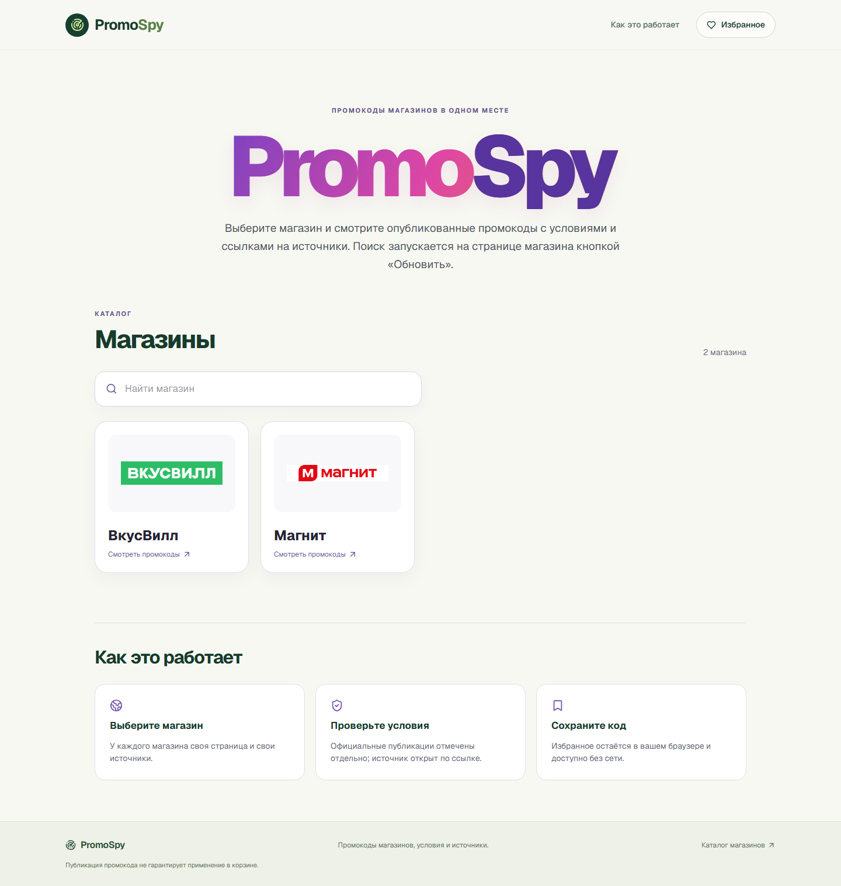

# PromoSpy — промокоды магазинов

Сайт с опубликованными промокодами ВкусВилл, Магнит, METRO, ЁДО Суши (Ковров), Fox Pizza (Иркутск) и «Алло! Пицца» (Москва). На главной видны состояние сбора и время последнего успешного чтения.

**Версия 0.19.0.** Живой поиск работает в запущенном Node-приложении.

 [Что изменено и что сделать после скачивания](NEXT_STEPS.md) · [Подробный запуск](START_HERE.md) · [Docker](docs/docker.md)



[Вид на телефоне](docs/design-mobile.png).

## Скачать и передать другу

Скачайте ZIP нужной версии или клонируйте [репозиторий](https://github.com/Startcpc/promospy). Собрать ZIP из чистого коммита можно командой `pnpm package:zip`. В архиве весь исходный проект, скрытые настройки, lockfile, тесты и файлы запуска. Git для работы распакованного ZIP не нужен.

Распакуйте архив полностью. Установите Python 3.9+ и запустите:

- **Windows:** двойной клик по `START_WINDOWS.cmd` или `python start.py`.
- **macOS / Linux:** `python3 start.py`.

Лаунчер подготовит Node.js и зависимости, соберёт приложение и откроет **http://localhost:3000**. Первый запуск требует интернет и может занять несколько минут. Остановка — **Ctrl+C**. Повторный запуск использует подготовленную сборку. Другой порт: `python3 start.py --port 3001`.

`node_modules`, кеш, секреты и сборка не входят в ZIP: лаунчер создаёт их для системы получателя. Избранное переносится отдельно через «Избранное → Перенос избранного».

## Docker

В папке распакованного проекта, с запущенным Docker Desktop или Docker Engine:

```sh
docker compose up -d --build --wait
```

Откройте http://localhost:3000. Остановка — `docker compose stop`. Логи — `docker compose logs -f --tail=100`. Сохраняйте постоянный том с кешем при обновлении. Команда собирает образ из текущих исходников. [Диагностика и настройка](docs/docker.md).

## Как пользоваться

1. На главной выберите магазин и нажмите **«Обновить»** на его странице.
2. Сравните предложения. Есть поиск по коду и условиям, фильтр официальных публикаций, скрытие истёкших, сортировка по сроку и минимальной сумме заказа.
3. Откройте условия карточки, скопируйте код или сохраните сердечком. Рядом с кодом видны сумма заказа и срок, если источник их указал.

После первого нажатия сервер обновляет данные каждые **5 минут**, пока запущен. При открытии новой страницы нажмите «Обновить». Старый кеш не подмешивается в свежий поиск; избранное сохраняет свои копии. Повреждённое обновление хранилища не стирает последний читаемый список открытой вкладки. Длинные условия сохраняются при экспорте и импорте.

Публикация кода не гарантирует применение в корзине. Официальная публикация отмечается отдельно. Неизвестные суммы и сроки не угадываются; разные условия одного кода остаются отдельными предложениями.

## Источники и ограничения

Для ВкусВилл сначала читается [официальная страница](https://vkusvill.ru/promocodes/), затем Пикабу, Промокоди, GetCashback, Promokod.com и Promocodex. Для Магнита используется [официальная страница промокодов](https://promo.magnit.ru/); сторонние каталоги для него пока не добавлены. Реестр и отключённые источники: [source-catalog.ts](src/lib/source-catalog.ts). Карты сайта, публичные ленты и поисковые индексы помогают находить страницы только на разрешённых доменах.

METRO и «ЁДО Суши» обновляются по одной официальной странице на магазин. У METRO минимальная сумма может зависеть от региона. У «ЁДО Суши» собраны акции, опубликованные для Коврова. [Правила METRO](https://online.metro-cc.ru/promo/promocode/), [акции ЁДО Суши](https://edosushi.ru/offers).

Fox Pizza читает список акций Иркутска. Для «Алло! Пицца» сборщик открывает карточки акций из официального списка и сохраняет ссылку на условия каждого кода. [Акции Fox Pizza](https://fox-pizza.ru/promotions), [акции Алло! Пицца](https://allopizza.su/actions).

Главная читает состояние из локального кеша и показывает «Актуальных промокодов нет» только после успешного чтения. Если источник дал ошибку или проверена лишь часть страниц, карточка показывает соответствующий статус. Первый свежий сбор по-прежнему запускается кнопкой «Обновить» на странице магазина.

Движок исключает маски кодов, чужие магазины и неполные предложения; сохраняет регистр. Ограничивает число запросов, повторяет временные ошибки, учитывает Retry-After и robots.txt. CAPTCHA, авторизация и отказ доступа пропускаются. Недоступность одного сайта не останавливает остальные. Скрытая вкладка и отсутствие сети приостанавливают опрос интерфейса.

Нужен **один постоянно работающий Node-процесс с постоянным диском**. Несколько реплик и serverless требуют другой координации. `/api/health` проверяет приложение и запись кеша, а не внешние сайты. [Установка на сервер](docs/server-setup.md).

Если сетевой клиент возвращает служебные DNS-адреса `198.18.x.x`, создайте `.env` в папке проекта с `PROMO_DNS_MODE=google-doh` и перезапустите сервер. Этот явный режим получает публичные IPv4-адреса через Google Public DNS по HTTPS. Google получает имена запрашиваемых доменов; проверка публичности IP, закрепление адреса соединения, TLS и robots.txt сохраняются. По умолчанию используется системный DNS. Если Google DNS недоступен, поиск сообщит ошибку. IP магазинов не зашиты в код.

Проверить живое автообновление можно командой `node scripts/verify-live-refresh.mjs http://127.0.0.1:3000` с запущенным сервером и установленным Chromium для Playwright. Скрипт нажимает «Обновить» для магазинов, закрывает вкладки и ожидает следующего серверного цикла около пяти минут. Чтобы проверить только Fox Pizza и «Алло! Пицца», добавьте к команде `211 212`. Отчёт сохраняется в `work/live-refresh-verification.json`.

## Разработка и проверки

Node.js 22.18+ и pnpm 11.25.0:

```sh
pnpm install --frozen-lockfile
pnpm dev
# Production:
pnpm build
pnpm start
```

```sh
pnpm exec playwright install chromium
pnpm check
# Либо использовать установленный Chromium:
PROMO_TEST_CHROMIUM_EXECUTABLE=/usr/bin/chromium pnpm check
# Отдельная проверка настоящей сети:
pnpm test:live 54
# Запущенное приложение: настоящий поиск, копирование и избранное в Chromium
pnpm test:live:ui http://127.0.0.1:3000
pnpm audit:sources 54
pnpm audit --prod
```

`pnpm check`: lint, TypeScript, unit-тесты, поиск, Python-лаунчер, production-сборка и браузерные сценарии. Синтетические тестовые коды не попадают в рабочие данные. Сетевые проверки зависят от доступности источников.

`pnpm package:zip` создаёт ZIP текущего чистого коммита и файл SHA-256 в `work/`. Нужен Git; архив содержит все отслеживаемые файлы, включая скрытые настройки. Это команда подготовки релиза, для запуска полученного ZIP она не нужна.

## Данные

Кеш: `.cache/promo-search` либо `PROMO_SEARCH_DATA_DIR`. Резервирование: `pnpm cache:backup`; восстановление после остановки сервера: `pnpm cache:restore /путь/к/копии.json`. Лаунчер поддерживает `--backup` и `--restore`.

Избранное хранится в браузере. Импорт принимает коды магазинов из текущего каталога и сообщает о пропущенных записях. При запрете постоянного хранилища приложение предупреждает, что изменения доступны только до закрытия вкладки. Кеш и личное избранное не включаются в архив проекта.

Дополнительные настройки, необязательные Chromium и локальная Ollama — в [.env.example](.env.example). Для обычного поиска они не нужны. Внешние AI API не используются.
