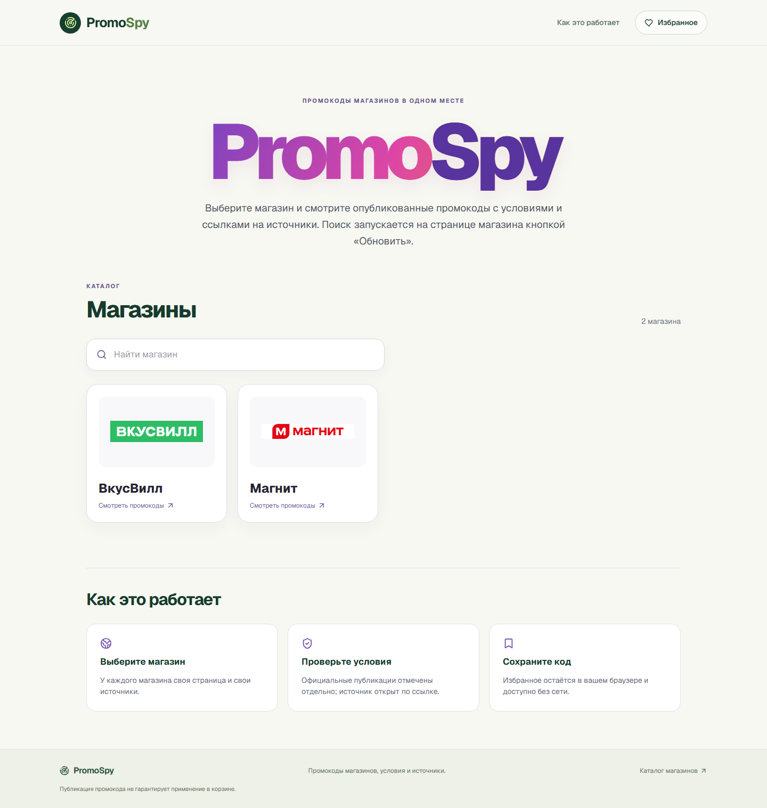
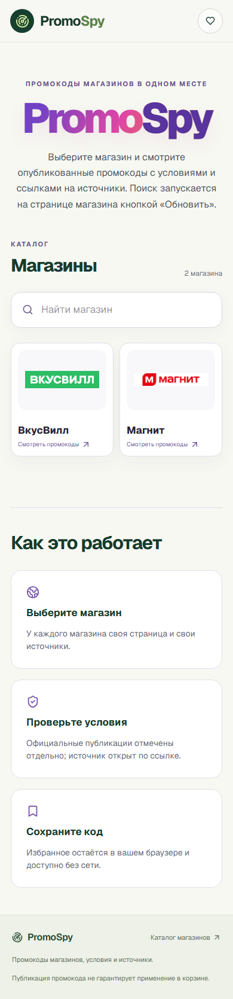

# Интерфейс 0.16

Светлая бумажная палитра, тёмно-зелёный акцент, крупная типографика и иллюстрация купона на главной. Иллюстрация описывает возможности приложения, а не изображает найденный промокод.

В поиске видны реальные счётчики, фильтры и сортировка. Срок и минимальный заказ вынесены на карточку; полный текст условий раскрывается кнопкой. Поиск и избранное используют общие компоненты. Ссылки на источники доступны рядом с кодами и на главной.

Поддерживаются клавиатура, ссылка перехода к содержимому, видимый фокус, `prefers-reduced-motion` и пауза радара. Кнопки не перемещаются при наведении. Текст и логотипы доступны без JavaScript; поиск и избранное требуют его.

Внешние шрифты, трекеры и библиотеки анимации не используются. Шрифты и логотип поставляются в проекте. Скриншоты показывают главную на компьютере и телефоне.

