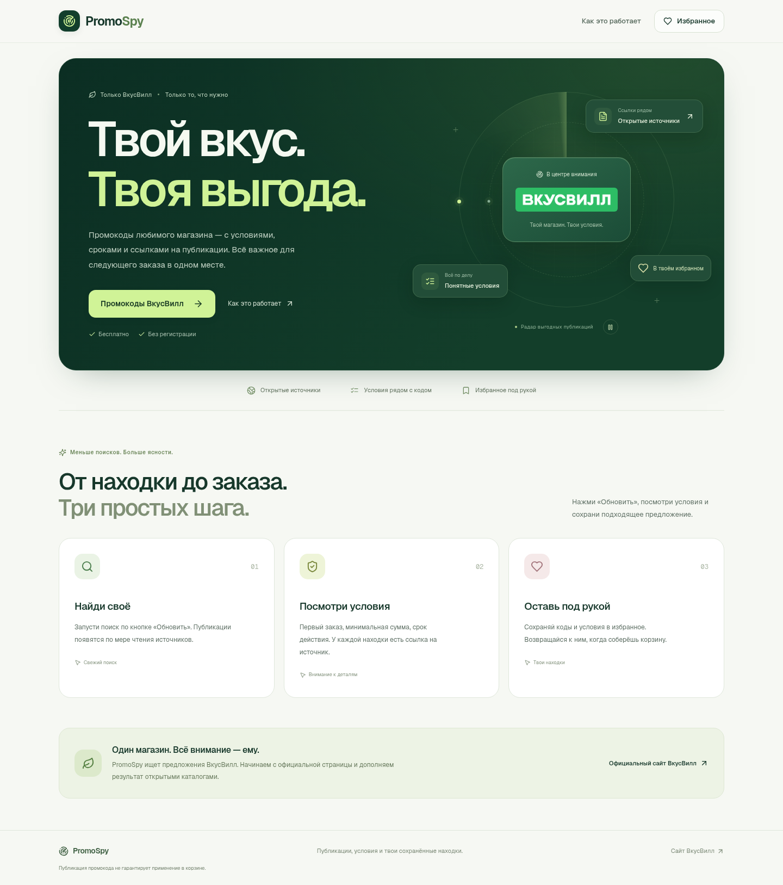
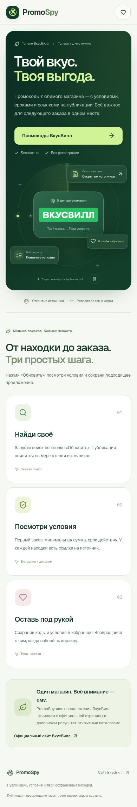

# Интерфейс PromoSpy 0.15

Новый интерфейс использует светлый фон, тёмно-зелёный первый экран и лаймовые акценты. Вместо ретро-рамок, наклонов и жёстких теней — тонкие границы, скруглённые карточки и мягкое движение. Страницы поиска и избранного используют общие шапку и подвал.

На первом экране движется декоративный радар вокруг настоящего логотипа ВкусВилл. Его карточки рассказывают о возможностях приложения; они не изображают найденные промокоды. Результаты поиска появляются только после нажатия «Обновить».

## Анимации

- Появление заголовка и карточек с небольшой последовательной задержкой.
- Подсветка первого экрана вслед за указателем на устройствах с мышью.
- Однократное появление нижних блоков при прокрутке.
- Вращение радара и плавное движение декоративных элементов; кнопка паузы доступна с клавиатуры.

Учитывается `prefers-reduced-motion`: анимации и переходы отключаются, содержимое остаётся видимым. Без JavaScript текст, логотип и ссылки доступны из серверного HTML. Кнопки и ссылки не перемещаются при наведении.

Ориентиры, просмотренные при разработке:

- [Motion — stagger](https://motion.dev/docs/stagger): последовательное появление элементов.
- [React Bits — Spotlight Card](https://www.reactbits.dev/components/spotlight-card): мягкое свечение вслед за указателем.

Реализация собственная, на CSS и IntersectionObserver. Эти библиотеки и сторонний код не добавлены в зависимости; внешние сервисы и API для анимаций не вызываются.

## Проверка 14 ноября 2026 года

Полный `pnpm check` прошёл: 263 unit-теста, 25 проверок поиска, 12 тестов лаунчера, lint, TypeScript, production-сборка и 9 Chromium-тестов. В браузерные проверки добавлены пауза/возобновление радара с клавиатуры и системное уменьшение движения. `pnpm audit --prod` не нашёл известных уязвимостей.

Production-образ `0.15.0` проверен через Chromium с настоящими источниками: свежий поиск после клика, повторное чтение, clipboard, избранное после reload и без сети, отключённое копирование истёкших кодов, отсутствие переполнения на ширинах 320, 768 и 1440 px. Ошибок JS, console и неожиданных HTTP-ошибок не обнаружено. Во время проверки получено 36 неистёкших предложений; их применение в корзине не проверялось.

